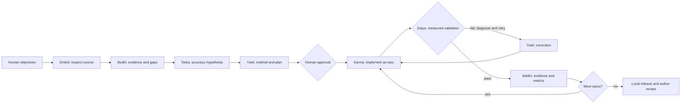

# Recorded SMART correction workflow

This document records the present revision, not a reconstruction of the original development history.

1. User requested a physics education revision and explicitly selected SMART.
2. The simulation repository was downloaded into writable home storage. A premature local experimental draft was preserved in a Git stash when the user requested download-only work.
3. SMART 6.2.3-smart.2 was cloned from https://github.com/ishwrknt/rmb-aid (commit cdfb46e6a91a19014719ddc4c53cfd5cead423f3) and installed for Codex.
4. On invoking @smart, source was inspected, five phases proposed and user approved with “yes”. Eight planning files were then written.
5. Baseline checks reproduced the velocity-sign error, artificial energy decay and omitted forces. One assertion was corrected because diagnostic acceleration changed while the actual trajectory did not; that distinction is recorded in the baseline check.
6. The earlier draft solver/interface/reference harness was reused explicitly, refined, and checked again. Angular and Cartesian formulations, work/loss accounting, independent references, teaching interface, data views and bounded storage were implemented. A history test exposed unsupported TypeScript parameter-property syntax in Node's strip-only loader; the constructor was rewritten and the check passed.
7. Satya checked actual numerical outputs, browser interactions, history, responsive screenshots, build and reference comparisons. Siddhi recorded measured timings and results. SMART roles are responsibilities within one coding assistant; no independent agents were spawned.
8. Release evidence and teacher notes were prepared locally. Journal manuscript revision, author review, deployment and classroom evaluation remain distinct future activities.

No speedup against conventional human development or measured educational improvement is inferred. Saved metrics report elapsed wall time, including tool/model time; added-line counts include reused draft code. They are not a controlled productivity experiment. The framework's Git source and npm identity must be cited as software if used in a manuscript, while original development claims require original records.

User-review extension: added physically explicit buoyancy and Reynolds-dependent sphere drag to both solvers, finite Stokes limit, effective-potential energy and drag dissipation. Four illustrative fluid scenarios, independent-variable experiments and blank recording sheet were added. Eight further reference trajectories and analytical/browser checks validate the numerical implementation. Added mass and unsteady effects remain omitted and disclosed.
